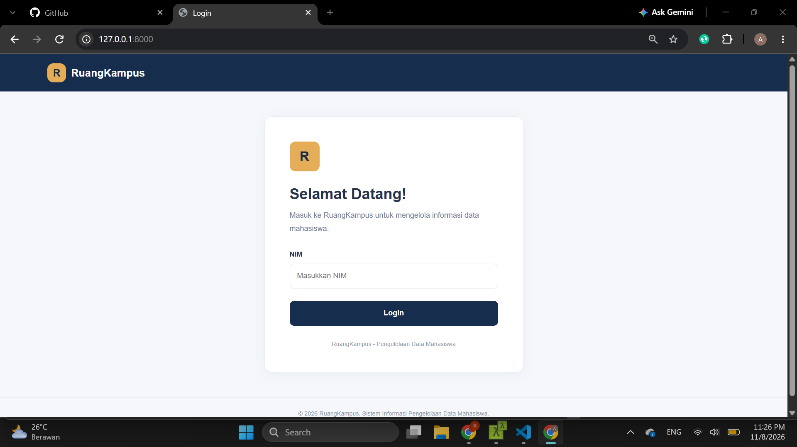
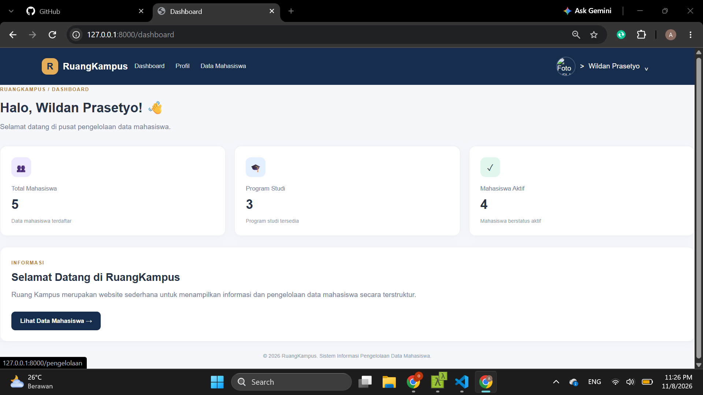
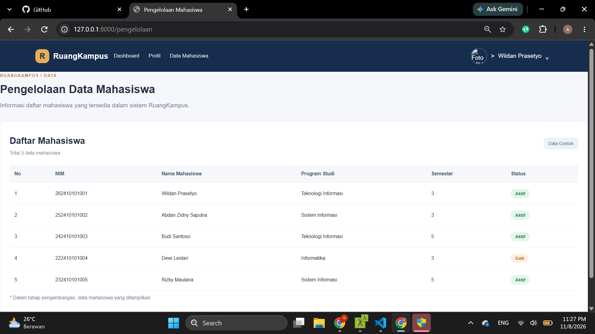
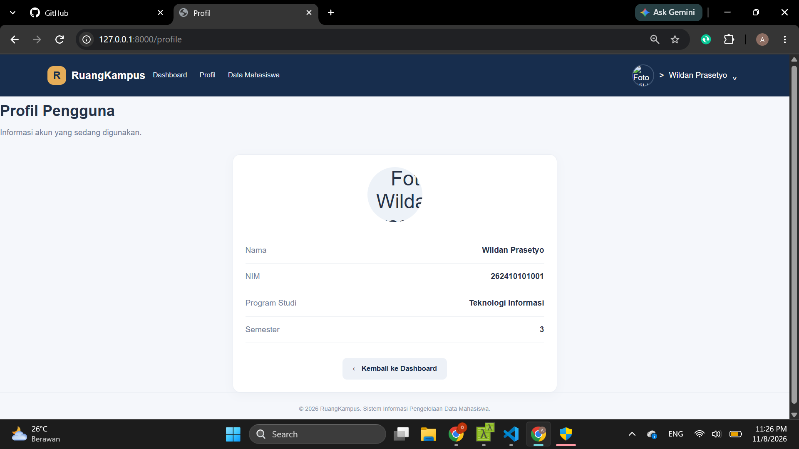

# RuangKampus – Aplikasi Pengelolaan Data Mahasiswa

## Deskripsi

RuangKampus merupakan aplikasi web sederhana untuk menampilkan informasi dan pengelolaan data mahasiswa. Aplikasi ini dibuat menggunakan Laravel 11 dengan menerapkan arsitektur MVC dan Blade Template.

## Teknologi yang Digunakan

- PHP
- Laravel 11
- HTML
- CSS
- Blade Template

## Fitur Aplikasi

1. **Login** – Halaman awal untuk memasukkan username pengguna.
2. **Dashboard** – Menampilkan ringkasan jumlah mahasiswa, program studi, dan mahasiswa aktif.
3. **Pengelolaan** – Menampilkan daftar data mahasiswa dalam bentuk tabel.
4. **Profil** – Menampilkan informasi pengguna.

## Aplikasi Tangkapan Layar

### Halaman Login

### Halaman Dashboard

### Halaman Pengelolaan

### Halaman Profil

## Tujuan Pembuatan

Aplikasi ini dibuat sebagai penerapan pembelajaran pengembangan web menggunakan Laravel 11, meliputi routing, controller, Blade Template, dan pengelolaan data mahasiswa.
